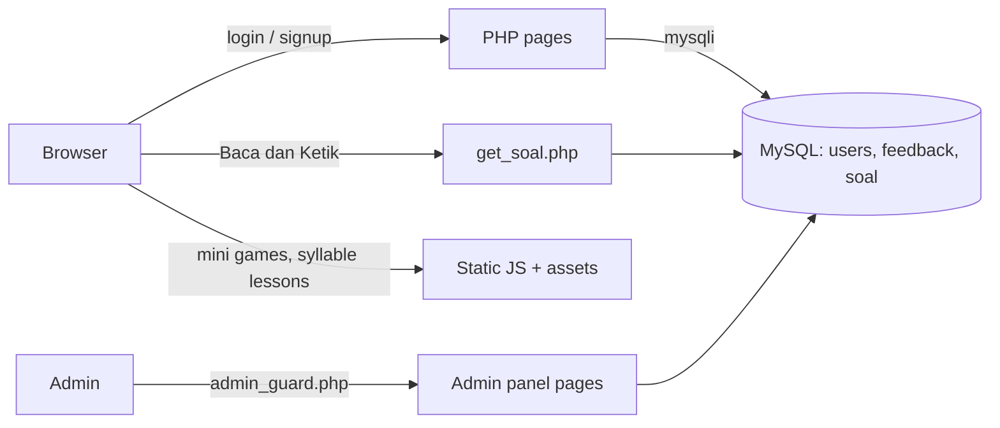
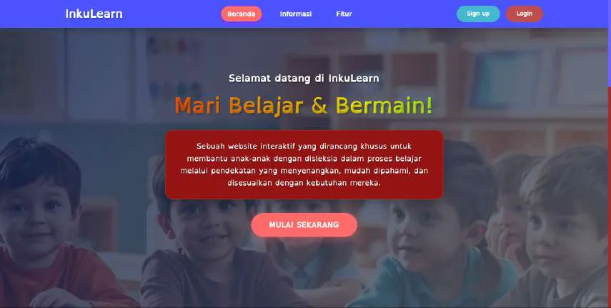
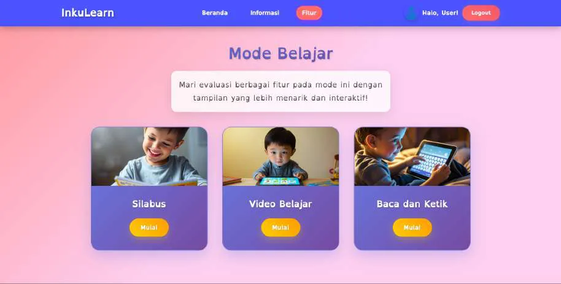
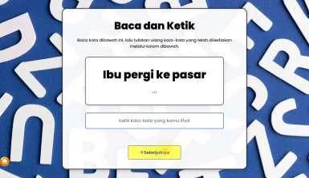
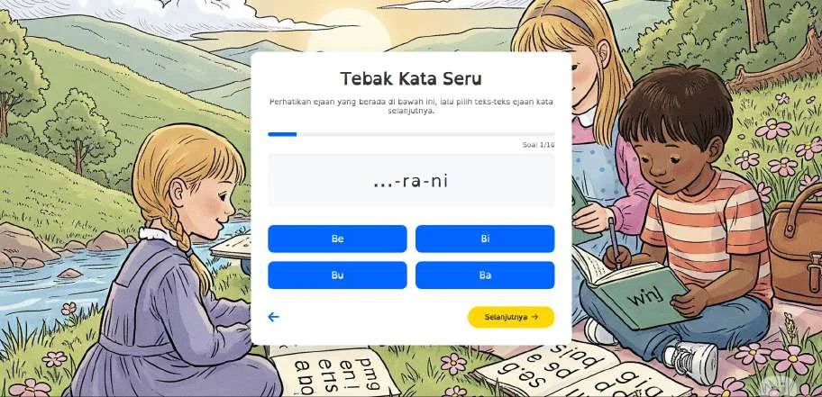

<h1 align="center">INKULEARN</h1>
<p align="center">A web app that helps children with dyslexia practice reading, through short lessons, typing exercises and mini games.</p>
<p align="center">
  
  
  
  
</p>

## Overview

Children with dyslexia often find standard reading material hard to follow. INKULEARN is a browser-based learning space for them: it uses the OpenDyslexic typeface, breaks words into syllables, and turns practice into short activities. It also includes an admin panel for managing users, feedback and exercise questions.

The project was a national finalist in GEMASTIK XVIII 2025 (Software Development category). During development it was trialled with 36 students and 1 teacher at an elementary school in Bandung; the average rating was 5/5 across five aspects (ease of use, design fit, participation, learning impact, stability).

## Features

- **Learning mode**: syllable breakdown of words, learning videos, and "Baca dan Ketik" (read and type) exercises.
- **Mini games**: "Tebak Kata Seru" (guess the word) and "Cocok Kata & Gambar" (match words to pictures).
- **Accounts**: sign up and log in; role-based redirect (user or admin).
- **Feedback**: logged-in users can send feedback from the information page.
- **Admin panel**: user data, admin data, feedback list, and create/edit/delete of the read-and-type questions.
- **Dyslexia-friendly UI**: OpenDyslexic font and animated three.js background scenes.

## How it works



## Screenshots

| | |
|---|---|
|  <br> Landing page |  <br> Learning mode menu |
|  <br> Baca dan Ketik |  <br> Tebak Kata Seru mini game |

## Getting started

Not tested end to end in this repository copy (PHP syntax was checked with `php -l`). Prerequisites: PHP 8 with the `mysqli` extension, and MySQL or MariaDB.

```bash
# 1. Create the database and demo data
mysql -u root -p < database/schema.sql

# 2. Configure the connection
cp config.example.php config.php      # edit host / user / pass / name
# (or set INKULEARN_DB_HOST, INKULEARN_DB_USER, INKULEARN_DB_PASS, INKULEARN_DB_NAME)

# 3. Run
php -S localhost:8000
```

Open `http://localhost:8000/index.php`. Demo accounts (fictional, created by `schema.sql`), password `demo1234`:

| Role | Email |
|---|---|
| admin | `admin@example.com` |
| user | `user@example.com` |

Notes:
- Fonts, Bootstrap, Font Awesome, three.js and the YouTube player are loaded from CDNs, so an internet connection is needed.
- Learning videos play through the YouTube iframe API; no local video files are included.
- Team photos on the information page were replaced with a placeholder avatar.

## Project context

Built by team "Restu Mamah" at UPI Kampus Cibiru for GEMASTIK XVIII 2025: Nabila Aulia Lailita (lead, UI/UX), Gavel Rizky Atallah (backend), Muhamad Davin Akbar Firdaus (frontend). Advisor: Dr. Eng. Munawir. Developed with an Agile method.

## Limitations

- No per-user progress saving.
- Content is limited to basic letters.
- Prototype-level security: the admin panel is guarded by a session role check, but there is no CSRF protection and some admin queries are still built by string concatenation.

## License

MIT, see [LICENSE](LICENSE).
